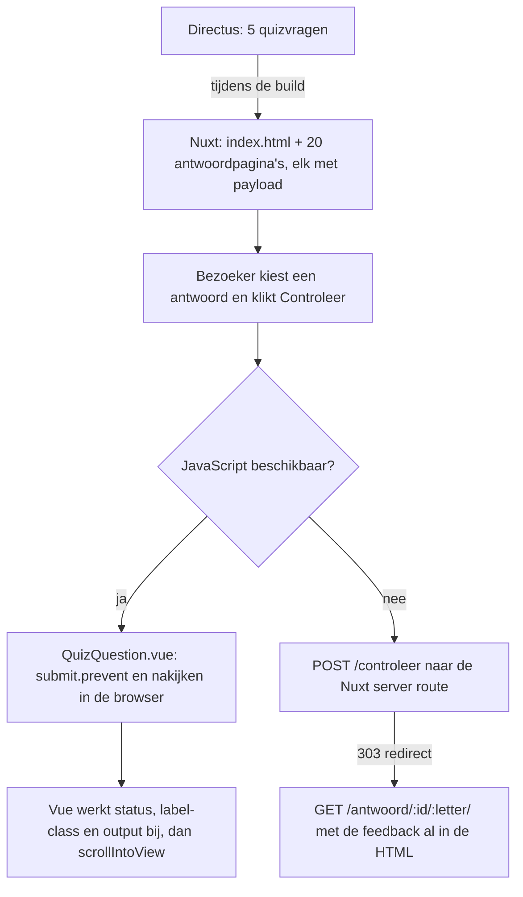

# justify-your-techstack: Nuxt

**Live:** https://quiz-nuxt.netlify.app · **Issue:** [#4](https://github.com/yassineAk1/justify-your-techstack/issues/4)

Onderzoek naar 11ty, Next.js en Nuxt voor de leertaak [Choices, Choices – The Tech-stack](https://github.com/fdnd-task/choices-choices-the-tech-stack/wiki). Elk framework heeft een eigen branch: `2-11ty`, `3-next` en `4-nuxt` (deze).

In elke branch staat dezelfde quiz: de Teylers-vragen uit Directus. Je kiest een antwoord, kijkt het na en krijgt uitleg. De referentie is de SvelteKit-quiz uit [`fdnd-agency/q42museumplatform`](https://github.com/fdnd-agency/q42museumplatform) (branch `dev`). HTML-structuur en CSS zijn in alle versies hetzelfde, zodat alleen het framework verschilt.

## Inhoud

- [Gebruik](#gebruik)
- [Hoe het werkt](#hoe-het-werkt)
- [Bewuste keuzes en verschillen met de referentie](#bewuste-keuzes-en-verschillen-met-de-referentie)
- [Bronnen](#bronnen)
- [Licentie](#licentie)

## Gebruik

```bash
npm install
npm run dev       # http://localhost:3000: alles werkt, ook nakijken zonder JS
npm run build     # productieversie (lokaal in .output/, op Netlify in dist/)
npm run preview   # draait de productieversie lokaal
```

Nuxt 4.7 met Vue 3.5. De Netlify-instellingen staan in [`netlify.toml`](netlify.toml): build `npm run build`, publish `dist`, Node 22 (net als de andere branches).

## Hoe het werkt

| Onderdeel | Waar | Renderstrategie |
|---|---|---|
| Vragen ophalen | [`app/components/Quiz.vue`](app/components/Quiz.vue) met `useFetch`, tijdens de build | SSG |
| Quiz-HTML | [`app/components/QuizQuestion.vue`](app/components/QuizQuestion.vue) | SSG + hydratie |
| Nakijken met JS | `check()` in `QuizQuestion.vue` | CSR |
| Nakijken zonder JS | form POST → [`server/routes/controleer.post.ts`](server/routes/controleer.post.ts) → 303 naar `/antwoord/{id}/{letter}/` | Server route + SSG |

`/` en de 20 antwoordpagina's ([`app/pages/antwoord/[id]/[letter].vue`](app/pages/antwoord/%5Bid%5D/%5Bletter%5D.vue)) worden tijdens de build geprerenderd, via `routeRules` en de hook `prerender:routes` in [`nuxt.config.ts`](nuxt.config.ts). Alleen de POST naar `/controleer` draait op de server. Op Netlify wordt dat vanzelf een function.



## Bewuste keuzes en verschillen met de referentie

- **Statisch in plaats van SSR.** `/` en de antwoordpagina's zijn geprerenderd, net als bij 11ty. Zo meet je het verschil in framework-JS, en niet het verschil tussen een bestand en een function. De vragen veranderen zelden.
- **Nakijken zonder JS binnen Nuxt.** Een server route in `server/routes/`, geen losse Netlify Function zoals bij 11ty.
- **Het goede antwoord staat in de bron.** Nuxt zet de data uit `useFetch` in `_payload.json`, inclusief `is_correct`. Dat bestand wordt ook zonder JS geladen (`<link rel="preload">`). In de SvelteKit-versie zit het in de hydratiedata. Voor een museumquiz zonder punten is dat acceptabel.
- **Zonder JS verandert de URL** naar `/antwoord/…`. In SvelteKit blijft die `/`. Er zit ook één extra stap in: de redirect.
- **Twee componenten** (`Quiz`, `QuizQuestion`), zoals `Quiz.svelte` en `QuizQuestion.svelte` in de referentie. De antwoordoptie zit hier in `QuizQuestion`.
- **`vue-router` 5.5.2 brak de build.** Die versie (26-11-2026) liet het prerenderen falen met `__VUE_OPTIONS_API__ is not defined`. Daarom stond `vue-router` even vast op 5.5.1. Zes uur later kwam [5.5.3](https://github.com/vuejs/router/releases/tag/v5.5.3) met de fix, dus nu staat er weer `^5.5.3`.
- **Alleen Inter**, met dezelfde `style.css` als de andere branches. Nuxt geeft CSS en fonts een hash in de bestandsnaam.
- **De pagina heeft een eigen `<h1>`.** In de referentie zit de quiz onder een hero.

## Bronnen

- [Nuxt: Installation](https://nuxt.com/docs/4.x/getting-started/installation)
- [Nuxt: useFetch](https://nuxt.com/docs/4.x/api/composables/use-fetch)
- [Nuxt: Rendering modes](https://nuxt.com/docs/4.x/guide/concepts/rendering) (route rules, prerender)
- [Nuxt: pages/](https://nuxt.com/docs/4.x/directory-structure/app/pages) en [server/](https://nuxt.com/docs/4.x/directory-structure/server)
- [Nuxt: Lifecycle hooks](https://nuxt.com/docs/4.x/api/advanced/hooks)
- [Nuxt: Deploy to Netlify](https://nuxt.com/deploy/netlify)
- [Vue: Template refs](https://vuejs.org/guide/essentials/template-refs.html) en [nextTick](https://vuejs.org/api/general.html#nexttick)
- [MDN: 303 See Other](https://developer.mozilla.org/en-US/docs/Web/HTTP/Reference/Status/303) en [`<output>`](https://developer.mozilla.org/en-US/docs/Web/HTML/Reference/Elements/output)
- [SvelteKit: Form actions](https://svelte.dev/docs/kit/form-actions) (de referentie)

## Licentie

[MIT](LICENSE). Het Inter-font valt onder de SIL Open Font License.
