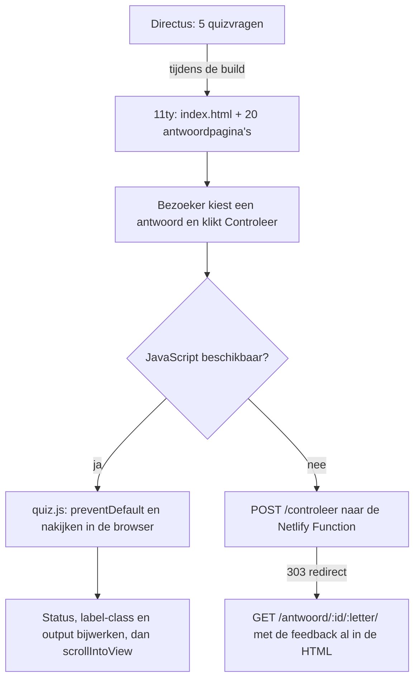

# justify-your-techstack: 11ty

**Live:** https://quiz-11ty.netlify.app · **Issue:** [#2](https://github.com/yassineAk1/justify-your-techstack/issues/2)

Onderzoek naar 11ty, Next.js en Nuxt voor de leertaak [Choices, Choices – The Tech-stack](https://github.com/fdnd-task/choices-choices-the-tech-stack/wiki). Elk framework heeft een eigen branch: `2-11ty` (deze), `3-next` en `4-nuxt`.

In elke branch staat dezelfde quiz: de Teylers-vragen uit Directus. Je kiest een antwoord, kijkt het na en krijgt uitleg. De referentie is de SvelteKit-quiz uit [`fdnd-agency/q42museumplatform`](https://github.com/fdnd-agency/q42museumplatform) (branch `dev`). HTML-structuur en CSS zijn in alle versies hetzelfde, zodat alleen het framework verschilt.

## Gebruik

```bash
npm install
npm start        # alleen 11ty, http://localhost:8080: nakijken zonder JS werkt hier níet
npm run build    # bouwt naar _site/
```

Nakijken zonder JS gaat via een Netlify Function. Die draait niet in `npm start`. Lokaal heb je daarvoor de Netlify CLI nodig:

```bash
npm install -g netlify-cli   # eenmalig
netlify dev                  # 11ty + function, http://localhost:8888: alles werkt, ook zonder JS
```

## Hoe het werkt

| Onderdeel | Waar | Renderstrategie |
|---|---|---|
| Vragen ophalen | [`src/_data/quiz.js`](src/_data/quiz.js), tijdens de build | SSG |
| Quiz-HTML | [`src/_includes/quiz.njk`](src/_includes/quiz.njk) | SSG |
| Nakijken met JS | [`src/js/quiz.js`](src/js/quiz.js) (vanilla, ~1,7 kB) | CSR |
| Nakijken zonder JS | form POST → [`netlify/functions/check-answer.mjs`](netlify/functions/check-answer.mjs) → 303 naar `/antwoord/{id}/{letter}/` | Function + SSG |

11ty heeft zelf geen server. Zonder JS stuurt een kleine Netlify Function je door naar een vooraf gegenereerde antwoordpagina, gemaakt door [`src/antwoord.njk`](src/antwoord.njk): 5 vragen × 4 opties = 20 pagina's. Dat is een dynamische route die toch helemaal geprerenderd is.



## Bewuste keuzes en verschillen met de referentie

- **Het goede antwoord staat in de bron.** `quiz.js` leest het uit een `<script type="application/json">`. In de SvelteKit-versie zit het in de hydratiedata. Voor een museumquiz zonder punten is dat acceptabel.
- **Zonder JS verandert de URL** naar `/antwoord/…`. In SvelteKit blijft die `/`. Er zit ook één extra stap in: de redirect.
- **Alleen Inter** wordt geladen. Larken gebruikt de quiz niet.
- **De globale `header`-regel** uit de `style.css` van de referentie is weggelaten. Die hoort bij de site-header.
- **De pagina heeft een eigen `<h1>`.** In de referentie zit de quiz onder een hero.

## Bronnen

- [11ty: Global data files](https://www.11ty.dev/docs/data-global/) en [Pagination](https://www.11ty.dev/docs/pagination/)
- [Netlify: Functions overview](https://docs.netlify.com/build/functions/overview/)
- [SvelteKit: Form actions](https://svelte.dev/docs/kit/form-actions) (de referentie)
- [MDN: `<output>`](https://developer.mozilla.org/en-US/docs/Web/HTML/Reference/Elements/output), [`scrollIntoView()`](https://developer.mozilla.org/en-US/docs/Web/API/Element/scrollIntoView), [Progressive enhancement](https://developer.mozilla.org/en-US/docs/Glossary/Progressive_Enhancement)
- [Zach Leatherman: Site generator review](https://www.zachleat.com/web/site-generator-review/)

## Licentie

[MIT](LICENSE). Het Inter-font valt onder de SIL Open Font License.
