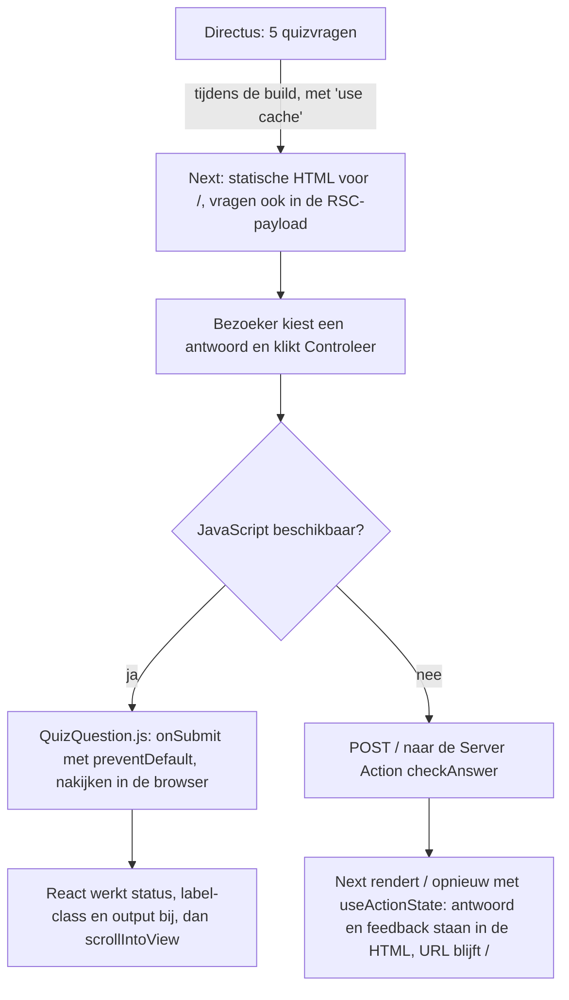

# justify-your-techstack: Next.js

**Live:** https://quiz-nextjs.netlify.app · **Issue:** [#3](https://github.com/yassineAk1/justify-your-techstack/issues/3)

Onderzoek naar 11ty, Next.js en Nuxt voor de leertaak [Choices, Choices – The Tech-stack](https://github.com/fdnd-task/choices-choices-the-tech-stack/wiki). Elk framework heeft een eigen branch: `2-11ty`, `3-next` (deze) en `4-nuxt`.

In elke branch staat dezelfde quiz: de Teylers-vragen uit Directus. Je kiest een antwoord, kijkt het na en krijgt uitleg. De referentie is de SvelteKit-quiz uit [`fdnd-agency/q42museumplatform`](https://github.com/fdnd-agency/q42museumplatform) (branch `dev`). HTML-structuur en CSS zijn in alle versies hetzelfde, zodat alleen het framework verschilt.

## Inhoud

- [Gebruik](#gebruik)
- [Hoe het werkt](#hoe-het-werkt)
- [Bewuste keuzes en verschillen met de referentie](#bewuste-keuzes-en-verschillen-met-de-referentie)
- [Bronnen](#bronnen)
- [Licentie](#licentie)

## Gebruik

```bash
npm install
npm run dev     # http://localhost:3000: alles werkt, ook nakijken zonder JS
npm run build   # productieversie in .next/
npm start       # draait de productieversie lokaal, http://localhost:3000
```

Next.js 16.4 met React 19.3. De Netlify-instellingen staan in [`netlify.toml`](netlify.toml): build `npm run build`, publish `.next`, Node 22 (net als de andere branches).

## Hoe het werkt

| Onderdeel | Waar | Renderstrategie |
|---|---|---|
| Vragen ophalen | [`app/lib/quiz.js`](app/lib/quiz.js) met `'use cache'`, aangeroepen in [`app/components/Quiz.js`](app/components/Quiz.js) (Server Component) | SSG |
| Quiz-HTML | [`app/components/QuizQuestion.js`](app/components/QuizQuestion.js) (`'use client'`) | SSG + hydratie |
| Nakijken met JS | `check()` in `QuizQuestion.js` | CSR |
| Nakijken zonder JS | form POST → Server Action `checkAnswer` in [`app/actions.js`](app/actions.js) → Next rendert `/` opnieuw met het resultaat (`useActionState`) | Server Action |

`/` wordt tijdens de build geprerenderd (`○ /` in de build-output, revalidate 30 dagen). Alleen de POST van een form zonder JavaScript draait op de server. Op Netlify wordt dat vanzelf een function.



## Bewuste keuzes en verschillen met de referentie

- **Handmatig geïnstalleerd** volgens [Manual installation](https://nextjs.org/docs/app/getting-started/installation#manual-installation), omdat deze branch al een README, LICENSE en `.gitignore` had. Wel met de instellingen die `create-next-app` aanraadt: Cache Components en Partial Prefetching (`next.config.mjs`). Zonder TypeScript, ESLint en Tailwind, zodat de code vergelijkbaar blijft met de 11ty- en Nuxt-versie.
- **Cache Components: `'use cache'` + `cacheLife('max')`.** In Next 16 onthoudt Next opgehaalde data alleen als je dat aangeeft. Met `'use cache'` komen de vragen in de statische HTML. `'max'` is het profiel voor "stable content that rarely changes": de pagina ververst hooguit eens per 30 dagen, zonder nieuwe build. Bij 11ty en Nuxt is een nieuwe build nodig.
- **Nakijken zonder JS met een Server Action.** De URL blijft `/`, net als in de SvelteKit-referentie. Er is geen redirect en er zijn geen 20 antwoordpagina's nodig, zoals bij 11ty en Nuxt. Anders dan in SvelteKit blijft de pagina zelf statisch: alleen de POST draait op de server.
- **Met JS geen server-request.** `preventDefault()` in `onSubmit` houdt ook de Server Action tegen, dus het nakijken gebeurt in de browser, net als bij 11ty en Nuxt.
- **`'use client'` alleen op `QuizQuestion`.** `page.js`, `layout.js` en `Quiz.js` zijn Server Components en sturen zelf geen JavaScript naar de browser.
- **React voegt iets toe aan de form:** `method="POST"`, `enctype="multipart/form-data"` en een paar verborgen inputs (`$ACTION_REF`, `$ACTION_KEY`) die de Server Action nodig heeft. De rest van de HTML is gelijk aan de andere versies.
- **Het goede antwoord staat in de bron.** De vragen gaan als props naar de Client Component, en die zitten inclusief `is_correct` in de RSC-payload in de HTML. In de SvelteKit-versie zit het in de hydratiedata. Voor een museumquiz zonder punten is dat acceptabel.
- **Alleen Inter**, met dezelfde `style.css` als de andere branches. Next geeft CSS en fonts een hash in de bestandsnaam.
- **De pagina heeft een eigen `<h1>`.** In de referentie zit de quiz onder een hero.

## Bronnen

- [Next.js: Installation](https://nextjs.org/docs/app/getting-started/installation)
- [Next.js: Caching](https://nextjs.org/docs/app/getting-started/caching) (Cache Components, `use cache`) en [cacheLife](https://nextjs.org/docs/app/api-reference/functions/cacheLife)
- [Next.js: Server and Client Components](https://nextjs.org/docs/app/getting-started/server-and-client-components)
- [Next.js: Mutating data](https://nextjs.org/docs/app/getting-started/mutating-data) (Server Actions, progressive enhancement) en [Forms](https://nextjs.org/docs/app/guides/forms)
- [Next.js: Metadata](https://nextjs.org/docs/app/getting-started/metadata-and-og-images)
- [React: useActionState](https://react.dev/reference/react/useActionState) en [flushSync](https://react.dev/reference/react-dom/flushSync)
- [Netlify: Next.js on Netlify](https://docs.netlify.com/build/frameworks/framework-setup-guides/nextjs/overview/)
- [MDN: `<output>`](https://developer.mozilla.org/en-US/docs/Web/HTML/Reference/Elements/output)
- [SvelteKit: Form actions](https://svelte.dev/docs/kit/form-actions) (de referentie)

## Licentie

[MIT](LICENSE). Het Inter-font valt onder de SIL Open Font License.
